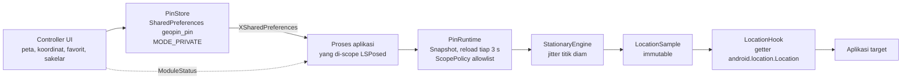
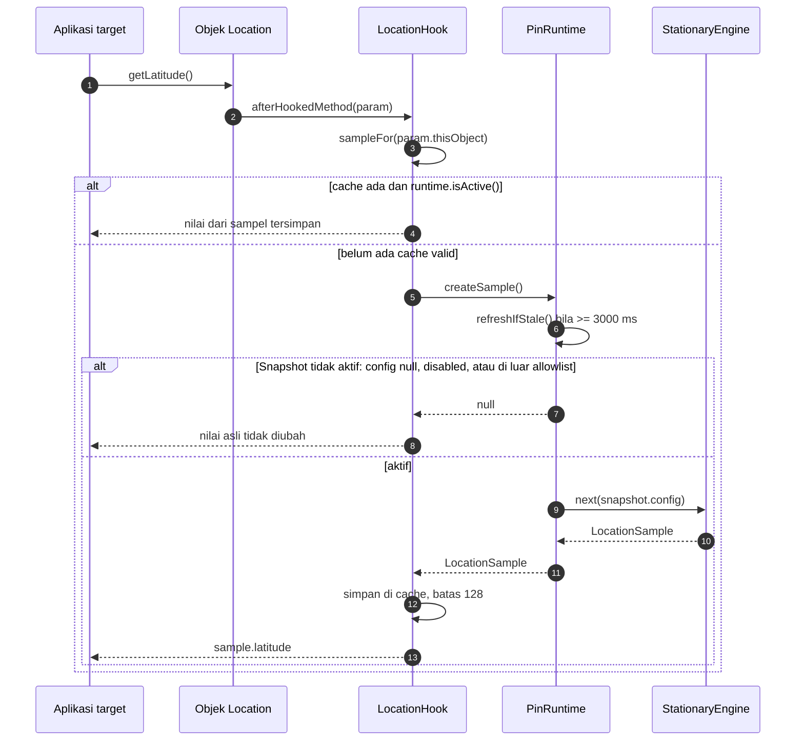
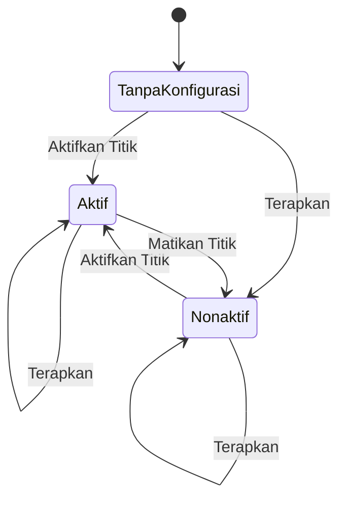

# Arsitektur

Modul LSPosed untuk satu titik GPS diam pada aplikasi yang dipilih. Tiga bagian: `core/` (Java murni,
tanpa Android), `app/` (controller dan hook LSPosed), `probe/` (pembaca lokasi diagnostik).
`minSdk 29`, `targetSdk 30`, `xposedminversion 82`.

## Alur data

`HookEntry` didaftarkan lewat `assets/xposed_init` dan dipanggil LSPosed di setiap proses yang
di-scope. `PinStore` menulis dengan `MODE_PRIVATE`; keterbacaan lintas proses diserahkan ke LSPosed
lewat meta-data `xposedsharedprefs`, bukan mode berkas legacy yang sudah ditolak framework.

## Satu pembaruan lokasi

Bila entri cache ada tetapi `isActive()` bernilai false, hook membuang entri itu dan mengembalikan
nilai asli tanpa membuat sampel baru. Pemeriksaan cache juga memanggil `isActive()`, sehingga
penyegaran 3 detik ikut terjadi pada jalur cache hit.

Getter yang diganti: `getLatitude`, `getLongitude`, `getAltitude`, `getAccuracy`, `getSpeed`,
`getBearing`, `getTime`, `getElapsedRealtimeNanos`, `hasAccuracy`/`hasAltitude`/`hasSpeed`/`hasBearing`
(selalu `true`), dan `isFromMockProvider`/`isMock` (selalu `false`). Satu `LocationSample` dipakai
untuk semua getter pada objek `Location` yang sama, sehingga latitude, akurasi, altitude, dan waktu
konsisten.

## Kelas inti

| Kelas | Tanggung jawab | Imutabilitas |
| --- | --- | --- |
| `Coordinate` | WGS84 tervalidasi, parsing `lat, lon`, format 6 desimal | Immutable; field `final`, divalidasi di konstruktor |
| `PinConfig` | Pusat, ketinggian opsional, bearing, flag aktif, label | Immutable; `with*()` mengembalikan objek baru |
| `LocationSample` | Satu sampel lengkap yang dibaca hook | Immutable; field publik `final`, divalidasi |
| `ConfigCodec` | Serialisasi `key=value` berheader `geopin-pin/1` | Stateless; hanya metode statis |
| `ScopePolicy` | Aturan scoping dua lapis dan daftar paket terlarang | Immutable; salinan `unmodifiableSet` |
| `StationaryEngine` | Jitter titik diam dari `Random` dan `TimeSource` | Tidak immutable; state RNG, di-sinkronkan di hook |

`core/` juga memuat `Mercator` (proyeksi peta, stateless) serta `TimeSource`/`SystemTimeSource` (jam
yang bisa diganti saat tes); keduanya bukan bagian model titik diam.

Parameter mesin: drift maksimum 0,9 m, akurasi 3,5-7,8 m, altitude +/-0,3 m, bearing +/-1,5 derajat,
speed 0,0. `PinConfig.resolvedAltitudeMeters()` menurunkan ketinggian otomatis (basis 45,2 m) bila
kolom ketinggian kosong.

## Scoping dua lapis

Paket menerima titik palsu hanya bila lolos dua syarat sekaligus.

| Lapis | Diatur di | Bila tidak terpenuhi |
| --- | --- | --- |
| Scope LSPosed | LSPosed Manager | `HookEntry` tidak dipanggil di proses itu; tidak ada hook sama sekali |
| Allowlist controller | Kolom "Paket yang diizinkan" lalu "Simpan Cakupan" | Hook terpasang, tetapi `createSample()` mengembalikan `null` |

`ScopePolicy.isInjected()` selalu menolak:

- `android`, `com.android.systemui`, `com.google.android.gms`, `com.google.android.gsf`,
  `com.google.android.gms.persistent`
- paket controller sendiri (`BuildConfig.APPLICATION_ID`)

`LocationHook.install()` juga berhenti lebih awal untuk paket terlarang. Allowlist dibaca dari
`KEY_ALLOWLIST` dan dipisah koma atau spasi; default saat controller pertama kali dibuka hanya
`dev.geopin.probe`.

Controller tetap harus dicentang di LSPosed meski tidak pernah menerima lokasi palsu: indikator
"Status modul" memanggil `ModuleStatus.isActive()`, yang mencari kelas
`de.robv.android.xposed.XposedBridge` di proses sendiri. Kelas itu hanya ada bila modul aktif untuk
proses controller.

## Sakelar master dan jendela 3 detik

- Label tombol mengikuti status: "Aktifkan Titik" saat nonaktif, "Matikan Titik" saat aktif.
- Satu tombol: bila pusat, ketinggian, atau bearing berubah, konfigurasi disimpan langsung aktif; bila
  sama, flag `enabled` dibalik.
- "Terapkan" hanya menyimpan koordinat dan mempertahankan status aktif sebelumnya.
- `persist()` memanggil `saveConfig()` dengan `commit()`; hook membacanya lewat `refreshIfStale()`
  paling sering sekali per 3000 ms.
- Jendela 3 detik itu malas, bukan penjadwal: pemeriksaan hanya terjadi saat getter lokasi atau
  `isActive()` dipanggil. Tidak ada getter berarti tidak ada pembacaan ulang.
- Saat titik dimatikan atau paket dicabut dari allowlist, entri cache dibuang pada getter berikutnya.
  Saat pusat diganti tetapi titik tetap aktif, objek `Location` yang sudah punya sampel tetap memakai
  sampel lama.
- Perubahan scope LSPosed tidak tercakup jendela ini; proses target perlu dihentikan paksa agar
  `HookEntry` dipanggil lagi.

## Yang sengaja tidak ada

| Tidak ada | Alasan |
| --- | --- |
| Service latar di controller | Manifest hanya memuat `MainActivity`; tidak ada `Service`, `BroadcastReceiver`, atau penjadwal. Menutup UI menghentikan semuanya. |
| Callback terjadwal | Hook tidak membuat `Location` dan tidak memanggil listener. Bila provider tidak mengirim lokasi, tidak ada nilai palsu yang dibuat. |
| Mock provider | Tidak ada `addTestProvider` atau `setTestProviderLocation`; opsi "Select mock location app" tetap kosong. |
| `ACCESS_MOCK_LOCATION` | Manifest controller hanya `INTERNET`; controller tidak membaca lokasi perangkat. |
| Overlay atau simulasi rute | Hanya satu titik diam; tidak ada joystick mengambang atau pergerakan. |
