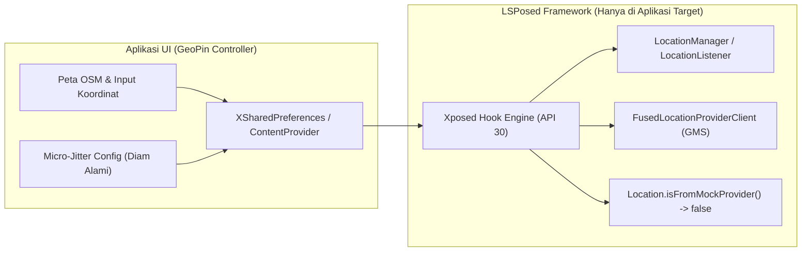

# Product Requirements Document (PRD)
**Nama Proyek:** GeoPin (LSPosed Stationary Location Module)  
**Target Perangkat:** Android 11 atau lebih baru  
**Lingkungan Eksekusi:** Root (Magisk / KernelSU / APatch) + Zygisk + LSPosed  
**Fokus Fitur:** Titik Diam (*Single-Point Stationary Pinning*)  
**Distribusi:** Proyek portofolio dan eksperimen

---

## 1. Tujuan & Ruang Lingkup Produk
Membangun aplikasi beserta modul *LSPosed* ringan untuk menetapkan satu titik koordinat (*stationary point*) pada aplikasi yang dipilih.

Karena hanya berfokus pada **Titik Diam**, aplikasi dirancang sangat ringan (*ultra-lightweight*), tanpa beban layanan *background* untuk kalkulasi rute atau *floating overlay joystick* yang memakan baterai dan RAM di chipset Helio G35.

---

## 2. Spesifikasi Target Perangkat
* **Perangkat:** Perangkat Android yang mendukung LSPosed
* **Sistem Operasi:** Android 11 atau lebih baru
* **Karakteristik Penting API 30 (Android 11):**
  * Pemeriksaan lokasi palsu pada Android 11 menggunakan `Location.isFromMockProvider()` (sedangkan `Location.isMock()` baru diperkenalkan di Android 12 / API 31).
  * Android 11 menerapkan *Package Visibility Filtering* (`<queries>`), yang memudahkan penyembunyian paket aplikasi pengendali dari aplikasi lain.

---

## 3. Arsitektur Teknis (LSPosed Scoped Module)

### 3.1 Mengapa Arsitektur Ini Sangat Efisien untuk Titik Diam?
1. **Tanpa Background Service Berat:** Berbeda dengan Fake GPS rute/joystick yang harus menjalankan *Foreground Service* terus-menerus, untuk **Titik Diam** modul LSPosed cukup membaca koordinat yang disimpan oleh aplikasi UI, lalu menambahkan *micro-jitter* langsung saat aplikasi target meminta lokasi.
2. **Pengaturan Developer Options Bersih:**
   * Opsi *Select mock location app* tetap **None / Kosong**.
   * `AndroidManifest.xml` tidak mendeklarasikan izin `ACCESS_MOCK_LOCATION`.
3. **Isolasi Aplikasi Target (Per-App Scope):**
   * Hanya aplikasi yang Anda centang di dalam **LSPosed Manager** yang menerima koordinat titik diam tersebut. Sistem utama dan aplikasi lain tetap membaca GPS asli.

---

## 4. Kebutuhan Fungsional (*Functional Requirements*)

### FR-01: Pemilihan Titik Diam (*Stationary Pin*)
* **Peta Interaktif Ringan:** Menggunakan *osmdroid* (OpenStreetMap) agar gratis, ringan, dan tidak memerlukan API Key berbayar Google Maps.
* **Input Cepat:** Kolom untuk menempelkan (*paste*) koordinat `Latitude, Longitude` secara langsung (misalnya disalin dari Google Maps).
* **Daftar Favorit:** Menyimpan beberapa titik lokasi yang sering digunakan beserta nama labelnya.

### FR-02: *Stationary Natural Micro-Jitter* (Realisme Titik Diam)
GPS asli pada saat HP diletakkan diam di atas meja **tidak pernah** menghasilkan angka koordinat dan akurasi yang 100% beku. Agar titik diam terlihat seperti sinyal satelit perangkat keras asli:
* **Micro-Drift Koordinat:** Setiap kali lokasi diminta, ditambahkan pergeseran acak sangat kecil (`±0.000003°` s/d `±0.000008°`, setara ~0.3 hingga 0.9 meter) di sekitar titik pusat.
* **Fluktuasi Akurasi:** Nilai `Accuracy` bervariasi secara alami di rentang `3.5m – 7.8m`.
* **Altitude Realistis:** Nilai ketinggian permukaan tanah diatur otomatis atau manual (misal `45.2m`) dengan fluktuasi kecil `±0.3m` (bukan `0.0m`).
* **Speed & Bearing:** Nilai `Speed` diset ke `0.0f` (karena diam) dan `Bearing` dipertahankan pada sudut terakhir yang wajar.
* **Sinkronisasi Waktu:** `time` dan `elapsedRealtimeNanos` selalu diperbarui sesuai waktu sistem saat *callback* lokasi dipanggil.

### FR-03: Sakelar Aktif/Nonaktif Cepat (*Master Toggle*)
* Satu tombol **Aktifkan / Matikan Titik** di halaman utama aplikasi.
* Indikator status apakah modul sudah aktif di LSPosed Manager atau belum (`isModuleActive()`).

---

## 5. Kebutuhan Non-Fungsional (*Non-Functional Requirements*)
* **Kustomisasi Package Name:** Menggunakan *applicationId* netral (contoh: `com.xos.system.calibrator`) dan nama aplikasi netral agar tidak terdeteksi oleh pemindaian daftar aplikasi.
* **Penggunaan Sumber Daya:** Penggunaan RAM `< 30 MB` saat UI dibuka, dan `0 MB` *background service* saat UI ditutup (karena logika injeksi berjalan di dalam proses aplikasi target melalui LSPosed).
* **Kompatibilitas:** Dikompilasi khusus untuk `minSdk 29` / `targetSdk 30` (Android 11) dengan dukungan *XSharedPreferences* standar LSPosed (`MODE_WORLD_READABLE` via `xposed_init`).

---

## 6. Tahapan Implementasi
1. **Tahap 1 – Persiapan Perangkat:** Unlock Bootloader, Root (Magisk/KernelSU/APatch), aktifkan Zygisk, dan instal LSPosed di Infinix Hot 11 Play.
2. **Tahap 2 – Pembuatan Proyek Android:** Setup Gradle, konfigurasi `xposed_init`, dan *package name* tersamar.
3. **Tahap 3 – Pembuatan Hook Engine (API 30):** Implementasi modul pembaca koordinat & *Stationary Micro-Jitter* untuk Android 11.
4. **Tahap 4 – Pembuatan UI Peta & Favorit:** Halaman peta pemilihan titik diam, daftar lokasi favorit, dan tombol *toggle*.
5. **Tahap 5 – Build APK & Pengujian di Perangkat:** Instalasi APK ke Infinix Hot 11 Play, aktivasi di LSPosed, dan verifikasi menggunakan aplikasi penguji GPS.
